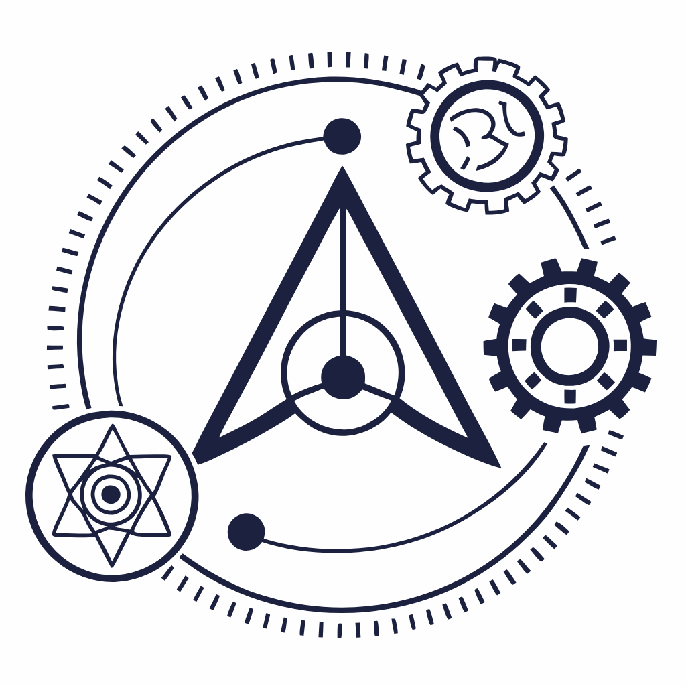

<div align="center">

  

**Security Scan orchestrator for AI Agents.**

Parsentry analyzes repository structure, enumerates attack surfaces, and generates per-surface analysis prompts. Pipe them to any CLI agent for parallel security analysis.

</div>

[](https://deepwiki.com/HikaruEgashira/parsentry) | [日本語](README.ja.md)

### [Agent Skill](https://agentskills.io/)

```bash
npx skills add HikaruEgashira/parsentry
```

Once installed, just ask your agent to scan a repository — the skill dispatches the scan process automatically.

### Usage

```bash
parsentry scan owner/repo | claude -p
```

`scan` is the only command you need. It inspects the cache and emits the prompt for the next phase (threat model → per-surface analysis → report). Every prompt tells the agent to re-run `parsentry scan` until it prints `PARSENTRY_SCAN_COMPLETE`, so one pipe runs the whole pipeline. Add `-o report.pdf` to also render a PDF.

The scan mode is decided from state, not flags:

| State | Mode |
|---|---|
| No threat model | **Full scan** |
| Threat model is current, some sources changed | **Incremental scan** — only affected surfaces re-run |
| Repository structure changed since the model was built | **Model diff scan** — the previous model and its findings are kept, a new model is built, and the report diffs the findings of both models |

See [HACKING.md](HACKING.md) for usage with other CLI agents.

### How it works

```
parsentry scan  ─┬─ model phase    →  threat model prompt                →  model.json
                 ├─ surface phase  →  orchestrator + per-surface prompts →  SARIF files
                 └─ report phase   →  merged.sarif.json + report.md (+ PDF)
parsentry log   →  monitor scan progress in real-time
```

1. **Model** — Collect repo metadata (languages, manifests, entry points), generate a threat model prompt. The agent enumerates attack surfaces into `model.json`.
2. **Surfaces** — Read source code per surface, generate focused `prompt.md` files and an orchestrator prompt that launches parallel subagents — each writes SARIF results. Surfaces whose definition and sources are unchanged are skipped.
3. **Report** — Merge SARIF of the current model's surfaces and write `report.md` (with a model diff section when a previous model exists).
4. **Log** — Stream scan progress like `docker compose logs -f`.

### Install

```bash
# Via mise
mise use -g github:HikaruEgashira/parsentry

# Via cargo
cargo install parsentry
```

### Example Reports

| Repository | Surfaces |
|-----------|----------|
| [langgenius/dify](docs/reports/dify/) | 25 |
| [OWASP/NodeGoat](docs/reports/NodeGoat/) | 19 |
| [HikaruEgashira/hikae-vulnerable-python](docs/reports/hikae-vulnerable/) | 25 |

### License

AGPL 3.0
